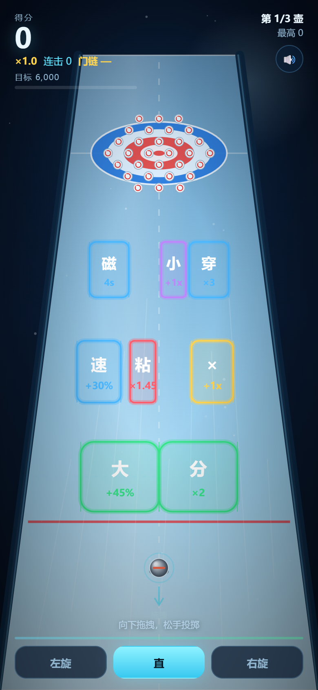

# 冰壶大作战 · 10 秒原型

> 暂定名。最终名称需按抖音小游戏命名规范查重后再定，见 [`docs/NAMING.md`](docs/NAMING.md)。

一个用于验证核心爽感的可玩原型：**瞄准增益门 → 变大 / 分裂 / 加速 → 撞飞钉子 → 连锁清屏 → 爆分**。

- 形态：HTML5 Canvas 单页原型（无依赖、无需构建）
- 目标平台：抖音小游戏
- 最终引擎：**Cocos Creator 3.8.7+**（原型只用于验证手感和数值，见 [`docs/ENGINE_DECISION.md`](docs/ENGINE_DECISION.md)）
- 当前版本：v0.3 可玩原型（已通过浏览器 smoke test，见 [`docs/TEST_REPORT.md`](docs/TEST_REPORT.md)）



## 三种试玩方式

### 方式 1：一键启动（推荐，手机也能玩）

双击 **`play.cmd`**。

它会：

1. 启动本地服务器（默认 `http://localhost:5173`，被占用会自动换端口）
2. 自动打开浏览器
3. 打印局域网地址，手机连同一个 Wi-Fi 即可打开

也可以手动运行：

```bash
cd E:\Project\curling-gates
npm run play
# 或
node serve.mjs
```

### 方式 2：单文件版（方便发给别人）

双击 **`play-single.cmd`**，会生成并打开：

```
dist/curling-gates.html
```

这是一个把 CSS/JS 全部内联的独立 HTML，可以直接双击、发微信、丢到任何静态服务器。

### 方式 3：直接打开源文件

双击 `index.html` 也能玩（需要保持 `styles.css`、`game.js` 同目录）。

## 操作

| 操作 | 方式 |
|---|---|
| 瞄准 / 力度 | 在画面上按住并向下拖拽，拖得越远力度越大；松手投掷 |
| 方向 | 拖拽方向的反方向即投掷方向 |
| 旋转 | 底部「左旋 / 直 / 右旋」按钮 |
| 擦冰 | 滑行时按住画面（或空格），消耗体力降低摩擦、减小弧线 |
| 重开 | `R` |
| 静音 | 右上角按钮或 `M` |

## 当前实现（v0.3）

- 3 壶一局，3 排门，**30 个钉子**
- 8 种门：变大、分裂、加速、倍率、磁铁、穿透、变小+倍率、粘滞
- **钉子连锁**：撞中一个钉子后，最多触发两代连锁，制造“一壶清一片”的反馈
- **滑行加速**：滑动时间 ×1.55，单壶约 3.5~4.5 秒，减少等待感
- **门链**：连续命中门叠倍率，MISS 会断链；鼓励瞄准而不是随便投
- **目标与星级**：目标 6,000；3,000 / 6,000 / 10,000 对应 1 / 2 / 3 星
- **爽感反馈**：速度线、命中停顿、慢动作、大爆发（15 钉）、狂潮（25 钉）、连击音阶、震动
- 物理：固定 60Hz、摩擦、旋转弧线、擦冰、壶-壶碰撞、壶-钉碰撞、高速细分步进
- 计分：钉子分 + 大本营分 + 连击倍率 + 门链倍率 + 清屏奖励
- 结算：星级、最高分、最高倍率、最高连击、最高门链、每壶得分、“差 X 分”
- 移动端适配：竖屏、DPR、安全区、触摸、震动（支持时）

> 实测策略对比：直线投掷 29/30 钉 = 1,131 分；分裂 + 完美门 + 倍率 16 钉 = 2,443 分。**清屏多 ≠ 分高，门链、倍率和停球才是高分关键。**

## 文档

- [`docs/GAME_DESIGN.md`](docs/GAME_DESIGN.md)：整体玩法设计（增益门 + 滚雪球）
- [`docs/PROTOTYPE_SPEC.md`](docs/PROTOTYPE_SPEC.md)：可执行原型规格（物理参数、门数值、关卡布局、验收标准）
- [`docs/ENGINE_DECISION.md`](docs/ENGINE_DECISION.md)：引擎选型与 Cocos 迁移清单
- [`docs/NAMING.md`](docs/NAMING.md)：抖音小游戏命名规范、候选名与查重清单
- [`docs/TEST_REPORT.md`](docs/TEST_REPORT.md)：最近一次浏览器实测记录

## 文件结构

```
curling-gates/
├─ index.html           页面与 HUD
├─ styles.css           界面样式
├─ game.js              游戏逻辑 / 物理 / 渲染 / 音效
├─ serve.mjs            本地试玩服务器（零依赖）
├─ play.cmd             双击启动并打开浏览器
├─ build-single.mjs     生成单文件版
├─ play-single.cmd      双击生成并打开单文件版
├─ package.json         npm scripts，无依赖
├─ dist/                单文件试玩版（生成）
├─ README.md
└─ docs/
   ├─ GAME_DESIGN.md
   ├─ PROTOTYPE_SPEC.md
   ├─ ENGINE_DECISION.md
   ├─ NAMING.md
   ├─ TEST_REPORT.md
   └─ screenshots/
      ├─ aim.png
      ├─ aim-ghost.png
      ├─ slide.png
      ├─ sweep.png
      └─ result.png
```

## 已知限制

- 美术为程序化占位，不是最终风格
- 无后端、无排行榜、无广告 SDK
- 未做 Cocos 工程与抖音构建
- 音效为 WebAudio 合成，最终需替换为正式音效
- 震动依赖 `navigator.vibrate`，iOS Safari 不支持；抖音内需换 `tt.vibrateShort`

## 下一步

1. 试玩并调手感（力度曲线、摩擦、弧线、擦冰、连锁范围）
2. 确认「门」的数值与组合是否够爽
3. 做 Cocos 3.8.7 空工程 spike，实测抖音主包大小
4. 迁移 Cocos，接抖音 SDK
5. 补 15~20 关、每日残局、分享录屏、激励视频
