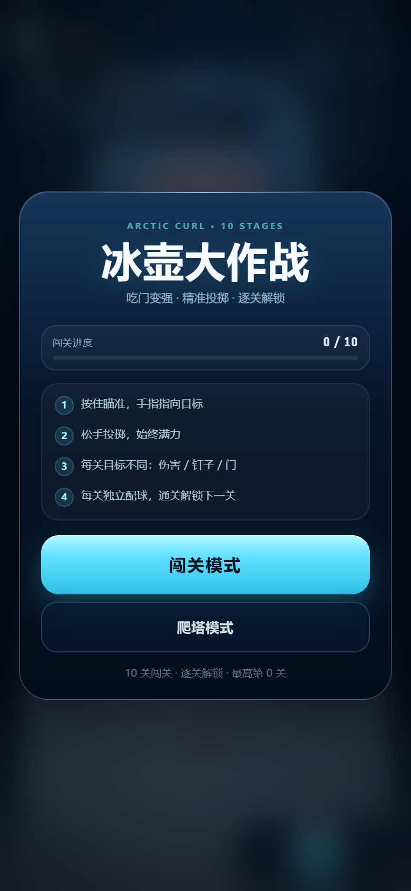
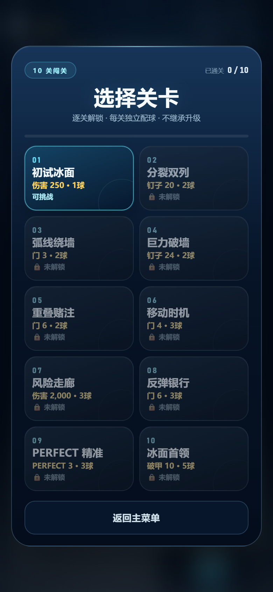
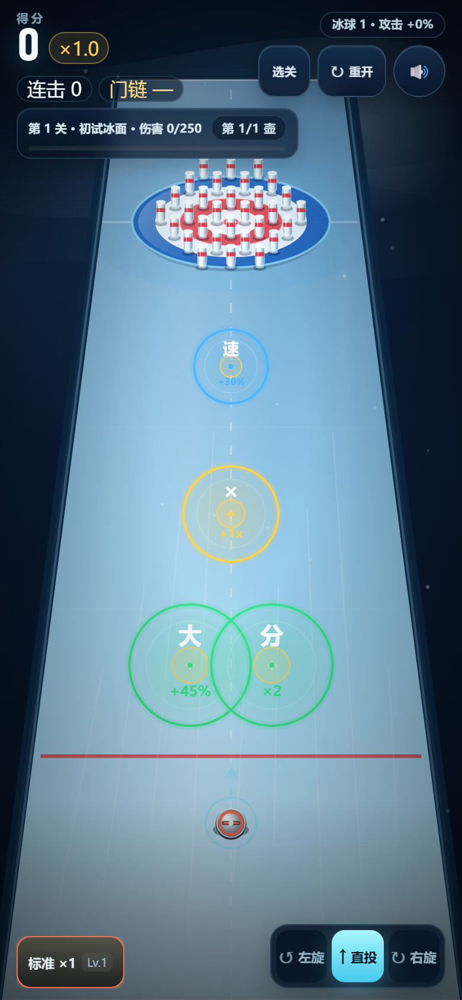
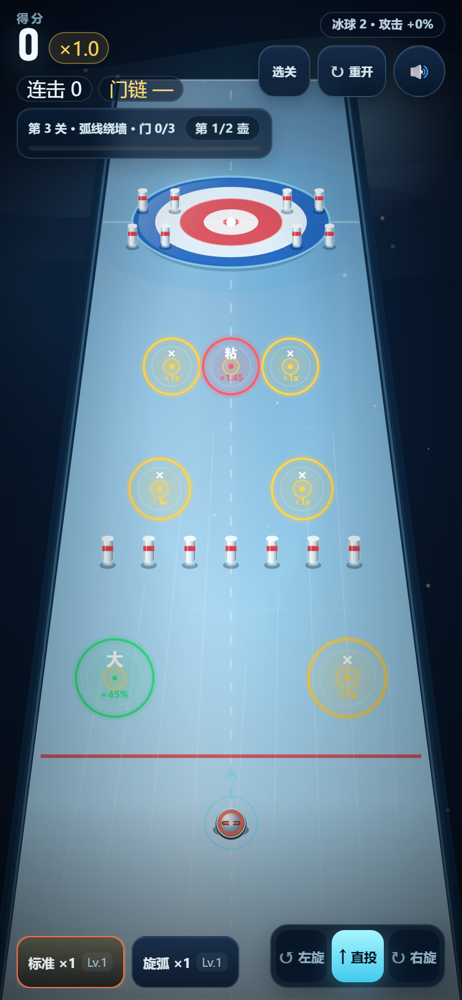
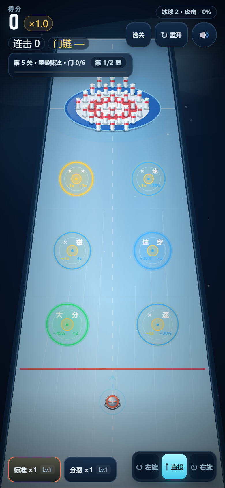

# 冰壶大作战 · 10 关闯关原型

> 暂定名。最终名称需按抖音小游戏命名规范查重后再定，见 [`docs/NAMING.md`](docs/NAMING.md)。

一个用于验证核心爽感的可玩原型：**瞄准增益门 → 变大 / 分裂 / 加速 → 撞飞钉子 → 连锁清屏 → 爆分**。

- 形态：HTML5 Canvas 单页原型（无依赖、无需构建）
- 目标平台：抖音小游戏
- 最终引擎：**Cocos Creator 3.8.7+**（原型只用于验证手感和数值，见 [`docs/ENGINE_DECISION.md`](docs/ENGINE_DECISION.md)）
- 当前版本：v0.8 可玩原型（**10 关闯关** + 冰球爬塔，已通过浏览器 smoke test，见 [`docs/TEST_REPORT.md`](docs/TEST_REPORT.md)）











## 三种试玩方式

### 方式 1：一键启动（推荐，手机也能玩）

双击 **`play.cmd`**。

它会：

1. 启动本地服务器（默认 `http://localhost:5173`，被占用会自动换端口）
2. 自动打开浏览器
3. 打印局域网地址，手机连同一个 Wi-Fi 即可打开

也可以手动运行：

```bash
cd E:\Project\curling-gates
npm run play
# 或
node serve.mjs
```

### 方式 2：单文件版（方便发给别人）

双击 **`play-single.cmd`**，会生成并打开：

```
dist/curling-gates.html
```

这是一个把 CSS/JS 全部内联的独立 HTML，可以直接双击、发微信、丢到任何静态服务器。

### 方式 3：直接打开源文件

双击 `index.html` 也能玩（需要保持 `styles.css`、`game.js` 同目录）。

## 操作

| 操作 | 方式 |
|---|---|
| 瞄准 | 按住后从冰壶到手指画一条延长线，**指哪瞄哪**；按住时移动手指调整 |
| 投掷 | 松手立即投掷，**始终满力**；没有力度条、没有蓄力条 |
| 旋转 | 底部「左旋 / 直 / 右旋」按钮；**选择会记住**，新球/重开/刷新后保持；弧线已加大 |
| 选球 | **闯关/爬塔模式**底部冰球条：**每种球一个按钮**，显示 `×剩余` 和等级；同种多颗不重复占位；用过变灰 |
| 重开 | 右上角「↻ 重开」或 `R`，随时重置本局 |
| 静音 | 右上角按钮或 `M` |

## 当前实现（v0.8）

- **两种模式**：**闯关模式（10 关独立关卡）**、爬塔模式（无限随机层）
- **UI V2**：顶部状态带 + 目标小胶囊 + 底部浮动控制；44px 触控目标、安全区、焦点态、`prefers-reduced-motion`；详见 [`docs/UI_DESIGN.md`](docs/UI_DESIGN.md)
- **Art Pass**：冰壶花岗岩高光 + 彩色手柄、立柱钉子、同心大本营、玻璃感门、冰面碎晶/反射/极光背景
- **闯关目标**：每关目标可以是伤害 / 钉子 / 门；达标立即过关
- **始终满力**：按住只瞄准，松手立即以旧版满力 **11.5 m/s** 投掷；取消蓄力、力度条、擦冰
- **瞄准线**：直接画**预测轨迹**（按摩擦/旋转/透视投影），从冰壶经过手指并延伸；准星在手指处，旋转时线会弯
- **圆形增益区**：每个 buff 是一个**完整可触发的圆**，直径 = 设计宽度；金色内圆 = PERFECT；不再有方形/条带状的无效区域
- **旋弧加大**：满旋横向约 2.0m，接近边线；旋转成为真正的路线选择
- **收尾加速**：低速摩擦增强，最后 0.5 秒左右停稳；球间等待 1 秒，点击可跳过
- **10 关手工布局**：一关一个课题；第 3 关起中心路线不再通吃，侧瞄/预判/完美逐步加入（详见 [`docs/CAMPAIGN.md`](docs/CAMPAIGN.md)）
- **选关 + 逐关解锁**：未通过前一关不能选后一关；已解锁关卡可重玩
- **每关独立配球**：没有过关三选一/升级/继承；每关使用预设冰球，进关重置
- **少球预算**：普通关最多 3 颗、Boss 最多 5 颗；一关 3 球过不了就改布局，不加球
- **机制递进**：分裂双列 → 弧线绕墙 → 巨力破墙 → 重叠赌注 → 移动时机 → 风险走廊 → 反弹银行 → PERFECT 精准 → 两阶段首领
- **路径钉子/钉墙**：钉子可以放在轨道中段挡路、制造窄口
- **失败无限重试**：本关球用光未达标 → 重试本关或返回选关，不消耗跨关资源
- 8 种门：变大、分裂、加速、倍率、磁铁、穿透、变小+倍率、粘滞
- **钉子连锁**：撞中一个钉子后，最多触发两代连锁，制造“一壶清一片”的反馈
- **门链**：连续命中门叠倍率，MISS 会断链；鼓励瞄准而不是随便投
- **爽感反馈**：速度线、命中停顿、慢动作、大爆发（15 钉）、狂潮（25 钉）、连击音阶、震动
- **爬塔模式**：初始 1 颗标准球；8 种冰球可重复获得；**每种球底部只有一个按钮（显示剩余数量）**；每颗球每层只能用一次；每层随机门/钉子 + 部分门移动；伤害达标立即过关；三选一新增球/强化该种类；DEF 300 起
- **分享成绩**：结算页可调用系统分享或复制成绩
- 物理：固定 60Hz、摩擦、旋转弧线、壶-壶碰撞、壶-钉碰撞、高速细分步进
- 计分：钉子分 + 大本营分 + 连击倍率 + 门链倍率 + 清屏奖励
- 结算：闯关显示到达关卡/最高通关/本关配球；爬塔显示层数/最高层
- 移动端适配：竖屏、DPR、安全区、触摸、震动（支持时）

> 闯关设计核心：第 1~2 关中心路线可通，第 3 关开始切换目标；第 5 关教学重叠门；第 7/9/10 关把减益、移动门和窄门压进主路线。

## 文档

- [`docs/CAMPAIGN.md`](docs/CAMPAIGN.md)：10 关闯关设计（目标/布局/难度曲线/通关规则）
- [`docs/LEVEL_TOOLING.md`](docs/LEVEL_TOOLING.md)：关卡设计工具调研（自研编辑器/模拟器/Tiled/LDtk 对比）
- [`docs/UI_DESIGN.md`](docs/UI_DESIGN.md)：UI/UX 设计说明（移动端层级、触控、安全区、动效）
- [`docs/GAME_DESIGN.md`](docs/GAME_DESIGN.md)：整体玩法设计（增益门 + 滚雪球）
- [`docs/PROTOTYPE_SPEC.md`](docs/PROTOTYPE_SPEC.md)：可执行原型规格（物理参数、门数值、关卡布局、验收标准）
- [`docs/TOWER_MODE.md`](docs/TOWER_MODE.md)：爬塔模式调研与设计（防御/三选一/冰球）
- [`docs/ENGINE_DECISION.md`](docs/ENGINE_DECISION.md)：引擎选型与 Cocos 迁移清单
- [`docs/NAMING.md`](docs/NAMING.md)：抖音小游戏命名规范、候选名与查重清单
- [`docs/TEST_REPORT.md`](docs/TEST_REPORT.md)：最近一次浏览器实测记录
- [`ROLLBACK.md`](ROLLBACK.md)：回退到 v0.3 基线的说明

## 文件结构

```
curling-gates/
├─ index.html           页面与 HUD
├─ styles.css           界面样式
├─ game.js              游戏逻辑 / 物理 / 渲染 / 音效
├─ serve.mjs            本地试玩服务器（零依赖）
├─ play.cmd             双击启动并打开浏览器
├─ build-single.mjs     生成单文件版
├─ play-single.cmd      双击生成并打开单文件版
├─ package.json         npm scripts，无依赖
├─ dist/                单文件试玩版（生成）
├─ README.md
├─ ROLLBACK.md          回退到 v0.3 基线
└─ docs/
   ├─ CAMPAIGN.md
   ├─ LEVEL_TOOLING.md
   ├─ UI_DESIGN.md
   ├─ GAME_DESIGN.md
   ├─ PROTOTYPE_SPEC.md
   ├─ TOWER_MODE.md
   ├─ ENGINE_DECISION.md
   ├─ NAMING.md
   ├─ TEST_REPORT.md
   └─ screenshots/
      ├─ campaign-menu.png
      ├─ campaign-level-select.png
      ├─ campaign-level1.png
      ├─ campaign-level3.png
      ├─ campaign-level5.png
      ├─ campaign-boss.png
      ├─ campaign-clear.png
      ├─ campaign-fail.png
      ├─ campaign-result.png
      ├─ aim-line.png
      ├─ curl.png
      ├─ tower-aim.png
      ├─ tower-clear.png
      ├─ tower-upgrade.png
      └─ tower-fail.png
```

## 已知限制

- 美术为程序化占位，不是最终风格
- 无后端、无排行榜、无广告 SDK
- 未做 Cocos 工程与抖音构建
- 音效为 WebAudio 合成，最终需替换为正式音效
- 震动依赖 `navigator.vibrate`，iOS Safari 不支持；抖音内需换 `tt.vibrateShort`

## 下一步

1. 试玩并调 10 关难度：通过率、目标值、减益密度
2. 爬塔模式数值：1~5 层通过率、冰球升级节奏、选球差异
3. 做 Cocos 3.8.7 空工程 spike，实测抖音主包大小
4. 迁移 Cocos，接抖音 SDK
5. 每日挑战 / 排行榜 / 分享录屏
